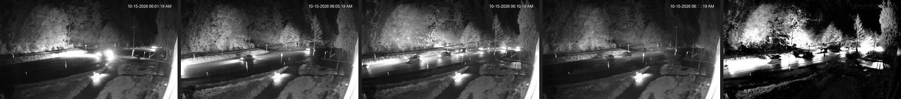
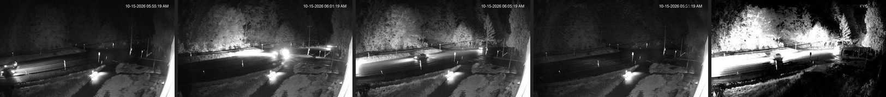

# Stable-pixel composites for the day crosswalk model and the terminal camera (2026-10-17)

The stable-pixel composite (median of a trailing window where a pixel is
stable, minimum where it moves; `compositeWindow` in
`functions/lib/lineup-features.js`) was designed on 2026-10-07 for the
**dark** crosswalk frames, where it removes passing headlights. The
published explainer with real examples is `composites.html` in the
classifier-results set (`scripts/build-composite-page.mjs`).

## Question

Tom (2026-10-17), after reviewing the night labelling page: "composite
could probably be helpful on all images to show stopped cars vs moving
cars." Two follow-ups: does the **day** crosswalk model do better on
composites, and does the **terminal** camera, whose departure timelapse
runs at about 1-minute spacing, so a standing queue barely moves between
frames while loading and passing cars do.

## Setup

- `scripts/experiments/day-composite-cv.mjs` — the lineup trainer's recipe
  (recency-weighted logistic regression, deterministic 5-fold CV by sailing,
  held-out sequence severity cost) on raw frames vs composites of the
  trailing window (≤3 frames, ≤7 min apart, same exposure mode). 11,676
  frames composited, 4,232 labelled daylight frames scored (3,340 with a
  full 3-frame window at 5-minute spacing). Lists the phantoms (detections
  on rider-refuted sailings) so each can be reviewed.
- `scripts/experiments/terminal-composite-cv.mjs` — the terminal trainer's
  recipe (brightness features of v1–v8, by-sailing 5-fold CV), raw frames vs
  composites of the trailing 3 (~2 min) and 5 (~4 min) frames at the
  camera's native 320×240, overall and per solar-elevation band; then the
  same variants inside the banded design (members below/above the horizon).

The first day run exposed a bug: the composite window's "same exposure
mode" test compared mean luminance, so a 06:35 infrared frame ghosted into a
06:40 colour composite. It was replaced by a colour-saturation test
(`maxInfraredSaturation`, `isInfrared`) and the run repeated; the numbers
below are from the repeat.

## Results

**Day crosswalk model** (5-fold CV, held-out):

| day features | P | R | severity cost | agree | missed | phantoms | early |
|---|---:|---:|---:|---:|---:|---:|---:|
| raw frames | 0.938 | 0.888 | **165** | 336 | 63 | 0 | 10 |
| stable composite (≤3 frames) | 0.946 | 0.896 | 184 | 338 | 60 | 2 | 10 |

Frame metrics improve slightly and the composite catches a few more
sailings, but it adds two phantoms (weight 10 each), which decide the
cost. Tom reviewed all three phantoms seen across the two runs: the two
composite-only ones (2026-08-24 12:35 on a near-empty lot, 2026-09-26 07:30
on an empty infrared twilight scene) are real false positives, the riders
were right; the one both variants shared (2026-08-13 13:55) was a rider
judging one row rather than the line reaching the crosswalk, and now
carries a hand mark at 13:50 in `training-data/lineup-crosswalk-hand.json`.
At 5-minute spacing a moving queue is partly erased and what survives can
look like a standing one.

**Terminal camera, single models** (5-fold CV, 1,769 labelled frames):

| features | P | R | F1 | false cars | false empties |
|---|---:|---:|---:|---:|---:|
| raw frames | 0.919 | 0.895 | **0.906** | 98 | 130 |
| composite k=3 (~2 min) | 0.906 | 0.886 | 0.896 | 113 | 141 |
| composite k=5 (~4 min) | 0.868 | 0.891 | 0.879 | 167 | 135 |

Per band the composite helped only below the horizon (twilight false cars
28 → 15, where the movers are headlight sweeps) and hurt in full daylight
(25°+: false cars 18 → 42). In daylight the movers this camera sees are a
mix of cars loading, cars unloading from the arriving boat and cars passing
on the road, some of which the label counts as waiting, so the minimum rule
erases evidence as often as noise.

**Terminal camera, inside the banded design:** banded raw/raw F1 **0.928**
(dark P 0.99 R 0.85, twilight P 0.97 R 0.78) vs composite-below-horizon /
raw-above 0.918 (dark P 0.91 R 0.72) vs composite-everywhere 0.893. Once the
low-sun band has its own member, raw frames beat composites in every band.

Example windows from the published page, both from the 2026-10-15 06:15
sailing (infrared, sun at about −12°). Each strip is the three frames that
went in, then the composite, then the map of pixels the composite replaced:

*06:01, 06:05, 06:10 and the composite judged at 06:10: the queue in the
lane survives, the moving car and its bloom on the road do not.*

*05:55, 06:01, 06:05 and the composite judged at 06:05: the headlight bloom
that fills the 06:01 frame is gone; what is left is the lit road and the
fixed street lights.*

## Conclusion

- Not adopted for the day crosswalk model at 5-minute spacing: the cost is
  two genuine empty-scene phantoms, and the crosswalk-box veto weakens when
  moving cars are erased. Worth re-running if the capture cadence tightens
  to 1 minute, where the composite loses far less of a real lineup.
- Not used on the terminal camera: the band split captures what the
  composite was buying, without the erased-car cost.
- Composites remain the design for the **night** crosswalk model, which
  still waits on positive sailings (979 hand-labelled dark frames, 11
  positive sailings as of 2026-10-17).

## What changed because of it

- `functions/lib/lineup-features.js`: `compositeWindow()` shared by trainer,
  labelling page and server; infrared vs colour decided by colour saturation
  (`maxInfraredSaturation: 4`), with a test in
  `functions/test/lineup-composite.test.js`.
- `training-data/lineup-crosswalk-hand.json` gained the 2026-08-13 13:55
  mark; the exporter applies hand marks over rider marks.
- `composites.html` explainer page (`npm run lineup:composites-page`, in
  the nightly cron and the results deploy).

## Files

- `scripts/experiments/day-composite-cv.mjs`,
  `scripts/experiments/terminal-composite-cv.mjs`
- Caches: `training-data/experiments/cache/composite.bin`,
  `composite-index.json`, `day-composite-phantoms.json`,
  `terminal-composite-k3.json`, `terminal-composite-k5.json`
- Images: `docs/experiments/img/2026-10-17-composite-queue.jpg`,
  `img/2026-10-17-composite-sweep.jpg`
- Narrative: `docs/lineup-classifier.md` §4 "Night: stable-pixel composites"
  and §7 "Composites on the terminal cam"
