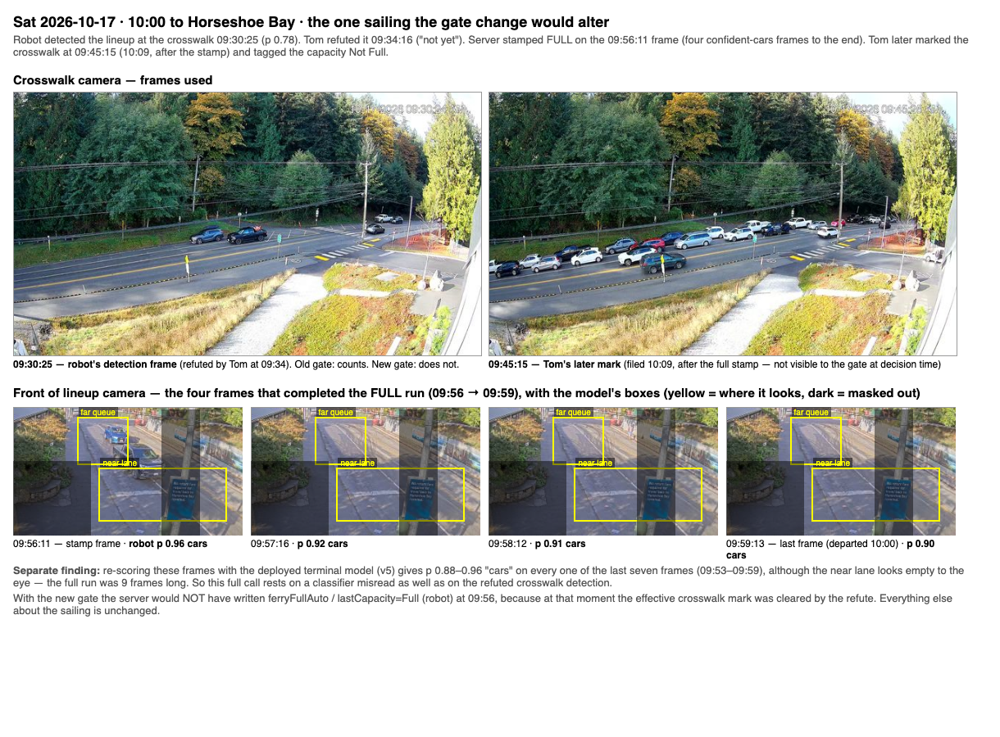

# Robot FULL call vs a refuted crosswalk detection (2026-10-17)

## Question

The server's "ferry left full" stamp is gated on the lineup having reached
the crosswalk (Tom's rule: no lineup to the crosswalk means the cars at the
end were probably late arrivals). The gate accepted either the robot's own
detection (`crosswalkFullAtAuto`) or the effective mark (`crosswalkFullAt`).
The detection is sticky: a rider's "not yet" clears the mark but not the
detection. Before changing the gate to the effective mark only, Tom asked:
which real sailings would that change, and what were the frames?

First the assumption itself had to hold: that a detection without a mark
means the detection was overruled. Verified two ways — the robot copies its
detection into the mark whenever its call stands and deletes both on
withdrawal (`crosswalk-robot.js`), and in production all five sailings with
a detection but no mark carried a rider refute of that exact detection.

## Setup

`scripts/experiments/full-gate-refuted-detection-scan.py`, read-only
against production: for every sailing in `aggregates/bowenSailings` with a
robot full stamp (80 of 664), replay the gate at the frame that completed the
final four-cars run (`dt[-4]`) using the sailing's `lineupReports`
timestamps — old gate (detection or mark) vs new gate (mark only).

## Results

Exactly **one** sailing changes: Saturday 2026-10-17 10:00 to Horseshoe Bay.

| Time | Event |
|---|---|
| 09:30:25 | robot detects the lineup at the crosswalk, p 0.78 |
| 09:34:16 | Tom refutes it ("not yet"); mark cleared, detection stays |
| 09:56:11 | server stamps FULL on the fourth confident-cars frame; old gate passes on the stale detection |
| 10:09:56 | Tom marks the crosswalk at 09:45:15 (after the stamp) and tags Not Full |

The sheet also showed something unplanned: the four terminal frames that
completed the FULL run look empty, yet the deployed model (v5) re-scored them
at 0.90–0.96 "cars", with a nine-frame run back to 09:53. The full call rested
on a classifier misread as much as on the refuted crosswalk. That became the
2026-10-18 terminal-features experiment.

## Conclusion

The gate change is safe (a standing robot call always has a mark) and
narrow (one sailing in six weeks on record). It would have blocked the 10:00
full stamp.

## What changed because of it

`functions/lib/webcam.js`: `crosswalkOk = cur.crosswalkFullAt != null`. Test
fixtures in `functions/test/webcam-capture-stale.test.js` now seed a standing
call (detection + mark) and a new test covers the refuted case. Committed as
"Robot full call needs the effective crosswalk mark, not the sticky
detection" (eed7aeb); needs a functions deploy.

## Files

- `scripts/experiments/full-gate-refuted-detection-scan.py`
- `docs/experiments/img/2026-10-17-full-gate-1000.png`
