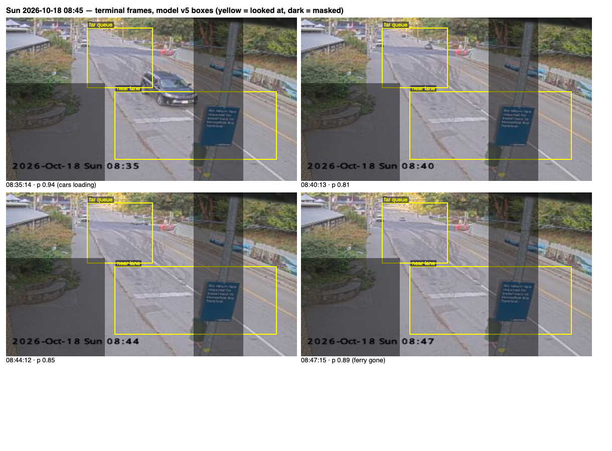
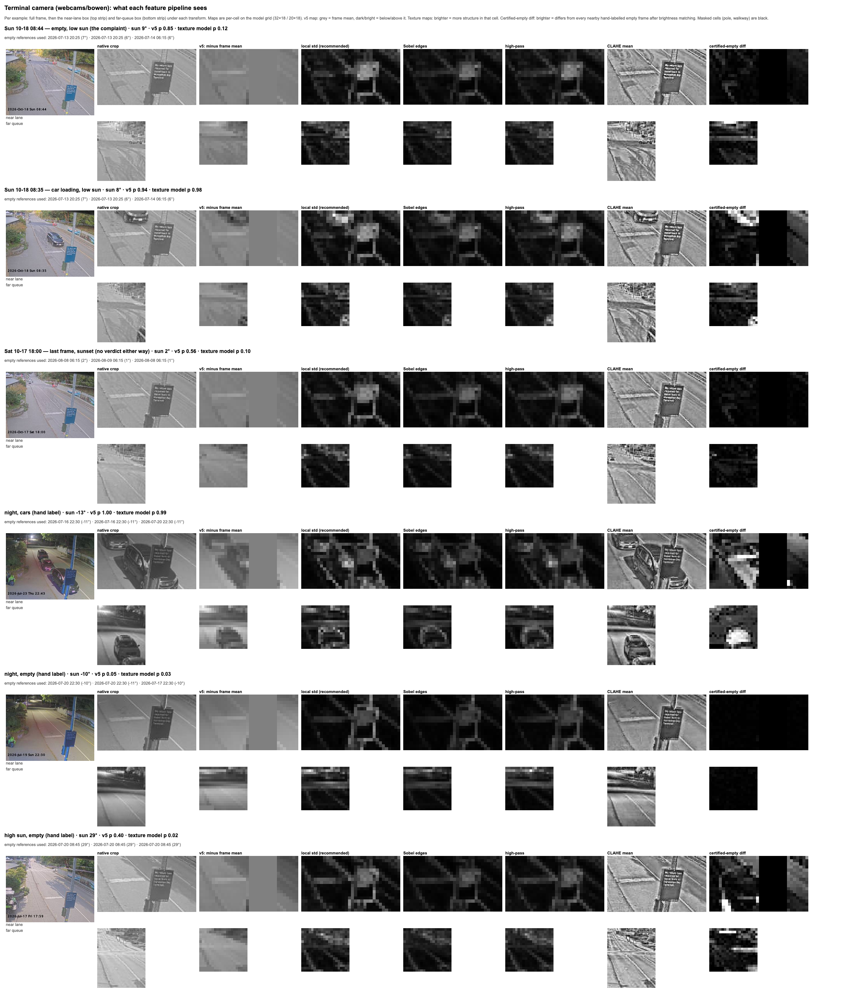

# Terminal-cars features at daybreak (2026-10-18)

Camera: the **Bowen terminal** camera (`webcams/bowen`, "front of lineup"),
not the community crosswalk camera. It has auto-exposure and a street light,
so its night performance is good; the trouble is low sun.

## Question

Tom reviewing the Sunday 2026-10-18 08:45 departure: the crosswalk robot was
sure the lineup never reached the crosswalk, yet the sailing was not called
"Not full", because the terminal-cars model kept reading an **empty road as
cars** (p 0.81–0.89 on every frame from 08:36 to 08:47). Roadworks had left
black marks on the asphalt. Is the background triggering the classifier, and
what filter or feature would stop it? Tom's hypothesis: a grey car on grey
road at that light is distinguishable to a human but not to the model, so
contrast or edges should help.

## What the deployed model (v5) was doing

Score decomposition of the empty 08:44 frame (`scratchpad` probe, kept in
the write-up because it decided the direction):

| Part | Contribution |
|---|---|
| bias | +1.79 (0.86 "cars" before any pixel; hand labels are 353 cars : 135 empty) |
| near-lane box | −0.41 (correctly says empty — the roadwork marks did **not** trigger it) |
| far-queue box | +0.33 (the sun-lit upper-left of the hill reads bright relative to the frame mean) |

v5's features were per-cell brightness minus the **whole-frame** mean. When
the near lane is full of dark cars the frame mean drops and the far road reads
bright, so the model learned "far queue bright = cars" — and low sun produces
exactly that pattern on an empty road. Across the archive, rider-tagged
"room" sailings got a robot not-full flag 76% of the time at 05:15 and
75–100% after 19:15, but only 19–24% at 07:30, 08:45 and 12:35.

## Setup

`scripts/experiments/terminal-features-experiment.mjs`. It caches, for all
~18.8k archived terminal frames, the raw region pixels at the model grid and
at 2×, plus native-resolution per-cell statistics (std, Sobel, high-pass,
CLAHE) in `training-data/experiments/cache/` (first run ~5 min, then
seconds). Frames are 320×240, so a near-lane cell is ~5.6 px square.

Each variant is trained as the same logistic model (LR 0.2, 600 epochs, L2
1e-4) with 5-fold cross-validation **by sailing** on the 488 hand labels, and
scored three ways:

- per frame on the hand labels, split by solar-elevation band (night < −7°,
  twilight −7..8°, low sun 8..25°, high sun > 25°);
- per frame on the 1,210 rider labels (never trained on);
- per **sailing** against rider capacity tags (582 "room", 179 "Full"),
  running the deployed tail rules on the out-of-fold predictions: how many
  room sailings get a not-full flag, how many Full sailings get a wrong one,
  and how often room sailings read "cars to the very end" (the input to a
  false FULL call).

The 13 Sunday frames (not in the archive) are scored by a model trained on
all hand labels.

Variants: `base` (v5's features), per-box centering, per-box z-score, class
balancing, blind rolling-median background subtraction, **certified-empty**
background subtraction (Tom's version: hand-label-0 frames only, nearest 3
by sun elevation, gain/offset matched per box, minimum difference kept),
2×-grid gradient, native Sobel, local std, high-pass, CLAHE, and stacks.

## Results

| Features | Frame F1 (hand, OOF) | Room sailings flagged not-full | Wrong not-full on Full-tagged | False "cars to end" on room, low-sun band | Sunday empty frames p |
|---|---|---|---|---|---|
| v5: brightness − frame mean | 0.924 | 58% | 1 | 13% | 0.79–0.88 |
| per-box centering | 0.920 | 59% | 2 | 12% | 0.79–0.87 |
| per-box z-score | 0.937 | 64% | 2 | 15% | 0.35–0.61 |
| blind median background | 0.798 | 43% | 11 | 14% | 0.67–0.79 |
| certified-empty reference | 0.948 | 65% | 2 | 5% | 0.14–0.35 |
| CLAHE | 0.929 | 71% | 0 | 9% | 0.29–0.64 |
| 2× gradient, z, balanced | 0.965 | 71% | 0 | 5% | 0.06–0.27 |
| **local std, z, balanced** | **0.971** | **71%** | **0** | **4%** | **0.09–0.32** |
| local std, plain | 0.971 | 70% | 0 | 3% | 0.23–0.46 |
| Sobel, z, balanced | 0.969 | 71% | 0 | 6% | 0.06–0.19 |
| high-pass, z, balanced | 0.968 | 71% | 0 | 4% | 0.03–0.10 |
| gradient + certified reference | 0.959 | 69% | 0 | 5% | 0.06–0.18 |

By lighting band for the chosen variant (local std, z, balanced) vs v5:
not-full coverage night 84% → 90%, twilight 60% → 74%, low sun 50% → 69%,
high sun 44% → 58%. Per-frame night recall is unchanged (0.706 on 43
frames). Full results per variant and band:
[2026-10-18-terminal-features-results.json](2026-10-18-terminal-features-results.json).

What each pipeline sees on real frames (near lane top, far queue bottom):

Rows: Sunday 08:44 empty (v5 0.85 → texture model 0.12), Sunday 08:35 with a
car loading (0.94 → 0.98), Saturday 18:00 last frame at sunset (0.56 → 0.10;
that sailing got no verdict either way because every frame hovered at 0.5),
night cars (1.00 → 0.99), night empty (0.05 → 0.03), high-sun empty
(0.40 → 0.02). The bright rectangle in the near-lane texture maps is the fare
sign; those cells are masked in the model.

## Conclusion

- The road marks were a red herring; the near lane already voted "empty".
  The failure is brightness features under low sun plus a strong "cars"
  prior.
- Texture beats shade. Four different texture features land within noise of
  each other at F1 ≈ 0.97 with zero wrong not-full flags, so the simplest
  (per-cell local standard deviation) is the one to ship.
- Certified-empty background subtraction is a real method (F1 0.948, and it
  removes the bias almost entirely) but trails texture, adds nothing when
  stacked on it, and needs a reference library that tracks the road.
- Blind background subtraction and CLAHE are not worth pursuing on this
  camera.

## What changed because of it

Feature set **`localStd-v1`** (2026-10-18): per-cell local standard deviation
of the native pixels, standardised per region (÷5 to keep the old value
range), masked cells zero. Shared arithmetic in
`functions/lib/terminal-feature-math.js`; server extractor
`functions/lib/terminal-features.js`; browser mirror
`src/composables/useTerminalClassifier.js`. The set name ships in the model
file and both runtimes refuse a model trained on another set. Trainer
`scripts/train-terminal-classifier.mjs` balances classes by default
(`--no-balance` to opt out) and excludes other-feature-set models from the
history comparison and nightly champion selection.

Retrained the same day as **model v7** (`npm run terminal:train`, hand +
rider labels, 1,435 train / 263 test frames): held-out precision 0.978 /
recall 0.924 overall, 0.980 / 0.943 on hand-labelled frames — v5's own
held-out was 0.933 / 0.792. Bias 1.72 (down from 1.79 despite the larger
rider-label imbalance). Earlier versions can no longer be re-scored on
today's split (different feature set), so the history table shows them
as-trained only. Needs a functions + client deploy to take effect; until
then the live code refuses the old model and the terminal classifier is
simply off.

## Files

- `scripts/experiments/terminal-features-experiment.mjs` — the experiment
  (`--variants a,b` to try new ideas against the cache).
- `scripts/experiments/terminal-feature-sheet.mjs` — the contact sheet.
- `docs/experiments/2026-10-18-terminal-features-results.json` — per-variant
  metrics.
- `docs/experiments/img/2026-10-18-terminal-0845-frames.png`,
  `img/2026-10-18-terminal-feature-pipelines.png`.
