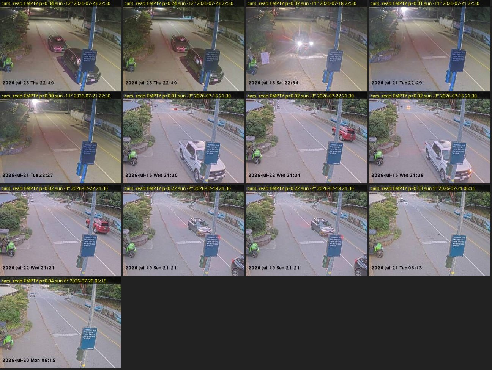

# Review of the texture terminal-cars model (saturn, 2026-10-18 evening)

Camera: the **Bowen terminal** camera. Subject: the laptop session's work of
2026-10-18, feature set `localStd-v1`
([2026-10-18-terminal-features-daybreak.md](2026-10-18-terminal-features-daybreak.md)),
reviewed before it goes live as model v10.

## Question

Tom: "give a review of the work done on the terminal classifier by the
other session. rerun the experiments and validate the assumptions, see if
you can find any other possible improvements or flaws."

Assumptions checked:

1. The experiment's numbers transfer: its cached pipeline equals the
   shipped extractor, and the browser mirror equals the server.
2. The headline results reproduce on the reconciled dataset (488 hand
   labels; saturn had 399 until today).
3. The trainer ships what the experiment tested. It does not: the
   experiment trained on hand labels only, the trainer trains on hand +
   rider labels since v7. Is that better or worse?
4. The operating point (threshold 0.5 with balanced classes), the training
   length (600 epochs) and the per-region z-score are sound.
5. Where the model still fails, and whether a brightness + texture stack
   recovers it.

## Setup

- Parity, experiment vs server: `scratchpad` script comparing the
  experiment's cached std channel (u8, ×1020) standardised with
  `standardizeRegions` against `extractTerminalFeatures()` on 163
  hand-labelled frames, features and v10 scores.
- Parity, browser vs server: headless Chromium (Playwright) running a
  verbatim copy of `extractFeatures()` from `useTerminalClassifier.js`
  against the same `terminal-feature-math.js` module and model v10, on 48
  hand-labelled frames, 12 per light band; compared with the server scores.
- `scripts/experiments/terminal-features-experiment.mjs`, extended with
  `--sweep` (frame and sailing-level metrics at thresholds 0.3/0.4/0.5/0.6),
  `--train-rider` (fold training on hand + rider labels) and two pipelines,
  `std+bal` (texture, no z-score) and `std+bright+z+bal` (texture and
  brightness side by side). Three runs: hand-only folds, hand + rider folds,
  hand-only at 1,500 epochs. Dataset: export of 2026-10-18 evening, 21,180
  frames, 488 hand + 1,383 rider labels, 568 room-tagged and 179 Full-tagged
  sailings.
- Error listing: out-of-fold `std+z+bal` predictions on the 152 hand frames
  below 8° sun, with a contact sheet of every error.

## Results

**Parity holds.** Experiment vs shipped extractor: feature max |Δ| 0.007
(range ±0.6), v10 score max |Δ| 0.003, 0 decision changes on 163 frames.
Browser vs server: score max |Δ| 0.009 (night), mean 0.001, 0 decision
changes on 48 frames. The Rec. 601 luma in the browser against libvips'
greyscale, and the two JPEG decoders, make no practical difference once
features are standardised per region.

**The headline reproduces exactly** on the reconciled data (hand-only
folds, as the laptop ran it):

| Variant | Frame F1 | night R (43) | twilight R (109) | Room flagged | Wrong not-full | False cars-to-end, room |
|---|---|---|---|---|---|---|
| brightness (v5 recipe) | 0.924 | 0.706 | 0.681 | 57% | 1 | 8% |
| **std+z+bal (shipped recipe)** | **0.971** | 0.706 | 0.830 | **71%** | **0** | **5%** |
| std+bal (no z-score) | 0.968 | 0.647 | 0.830 | 72% | 1 | 5% |
| std (no z, no balance) | 0.971 | 0.706 | 0.830 | 69% | 0 | 6% |
| std+bright+z+bal (texture and shade) | 0.968 | 0.706 | 0.809 | 70% | 0 | 7% |

**Training on hand + rider labels, as the trainer does, is slightly better
than the hand-only experiment** (so the trainer's choice is validated, and
the shipped model is a little stronger than the write-up claims):

| Fold training set | Frame F1 (hand OOF) | night R | rider P/R | Room flagged | Wrong |
|---|---|---|---|---|---|
| hand only (experiment) | 0.971 | 0.706 | 0.992 / 0.933 | 71% | 0 |
| hand + rider (trainer) | 0.975 | 0.824 | 0.997 / 0.936 | 70% | 0 |

**Threshold 0.5 is the right operating point.** Lowering it buys frame
recall at night (0.706 → 0.765 at 0.3) but costs not-full coverage
(71% → 67%), because the tail rule needs empties; raising it to 0.6 gains
two points of coverage and, in two variants, a wrong flag. Precision is
1.000 almost everywhere, so there is no free recall anywhere.

**1,500 epochs change nothing** (F1 0.971, coverage 70%, bias 1.36 → 1.94):
600 is converged for this problem.

**The brightness stack does not help**, including at night, where the
texture model's remaining misses are.

**Where it still fails.** All 13 out-of-fold errors below 8° sun are
*false empties*, no false cars at all:

- 9 of 13 are a **single vehicle** in the near lane at dusk or night (the
  white pickup, the red SUV, the dark car on 07-19): one smooth car body
  over a textured, street-lit road gives the cell grid little to see.
- 2 are the **far queue at dawn** (06:13, 06:15): cars only as dots at the
  top of the far-queue box.
- 2 (07-21 22:27, 22:29) have an **empty near lane and a headlight glare at
  the top of the frame**, labelled "cars"; the label is doubtful.

These misses are benign for the verdicts: a sailing with one car waiting
has room, so an empty reading there yields a correct not-full flag, and a
single car can never satisfy the FULL rule (four confident frames and the
crosswalk). That is why frame recall at night is 0.7–0.8 while the
sailing-level wrong-flag count stays at zero.

**Code review.** The feature-set gate is in the right places: the server
(`terminalModelUsable`, so also `refreshLiveModels` and the publish script),
the browser model loader (`accept` hook) and the trainer's history
re-scoring; brightness-era models cannot be installed or win champion
selection under texture code. The shared `terminal-feature-math.js` is the
single arithmetic for all three consumers, which the parity numbers confirm.
Tests cover server extraction and refusal; **there is no client unit test
for the model loader or the browser extractor at all** (`tests/` has none
for either composable), so the parity check above is the only evidence the
browser agrees. `evalHistoricalTerminal` returning null for other feature
sets means the history table can no longer show how v1–v8 would do today;
that is correct, not a flaw.

## Conclusion

The laptop's work holds up: the experiment transfers to production
unchanged, the browser mirror agrees with the server, the headline numbers
reproduce on the complete label set, and the trainer's deviation from the
experiment (rider labels in training) is an improvement, not a leak. No
change to the shipped recipe is warranted. Three things are worth doing
later, none blocking v10:

1. **Night and dawn labels.** The hand set has 17 car frames at night and 30
   empty frames at high sun; the misses are exactly where labels are
   thinnest. The dark-label page idea from the crosswalk side (a page of
   night terminal frames to confirm) would be cheap; rider labels already
   lift night recall from 0.71 to 0.82.
2. **A client unit test** that runs `extractFeatures` on a small fixture and
   compares with a stored server vector, so a future change to the canvas
   path cannot drift silently.
3. **Two doubtful night labels** (2026-07-21 22:27 and 22:29) to confirm or
   flip.

## Addendum: trimming the far-queue box's top edge

Tom's idea after the dusk labelling: the top of the far-queue box (6% down
the frame) is the distant road where a parked, an approaching and a turning
car look alike, so stop reading it. `--far-top` moves that edge down with
the bottom fixed; hand + rider training, 5-fold by sailing:

| far-queue top | Frame F1 (hand OOF) | night R (58) | twilight R (133) | Room flagged | Wrong not-full | False cars-to-end |
|---|---|---|---|---|---|---|
| **0.06 (current)** | **0.975** | **0.920** | 0.836 | 70% | **0** | **6%** |
| 0.15 | 0.976 | 0.920 | 0.852 | 70% | 1 | 7% |
| 0.20 | 0.966 | 0.800 | 0.836 | 70% | 0 | 7% |
| 0.25 | 0.952 | 0.760 | 0.803 | 70% | 0 | 7% |

No gain. A small trim is a wash with one extra wrong flag; deeper trims lose
night recall, because at night the far tail under the street light is where
a queue is most legible. The ambiguous distant cars are better handled where
they were: left out of the hand labels. Geometry unchanged.

## What changed because of it

- `scripts/experiments/terminal-features-experiment.mjs`: `--sweep`,
  `--train-rider`, pipelines `std+bal` and `std+bright+z+bal`; output file
  named by run.
- No change to the model or the trainer. v10 stands.

## Files

- `scripts/experiments/terminal-features-experiment.mjs`
- `docs/experiments/2026-10-18-terminal-texture-review-results.json` (three
  runs: hand-only, hand + rider, 1,500 epochs); far-top runs in
  `training-data/experiments/terminal-features-experiment-rider-fartop*.json`
- `docs/experiments/img/2026-10-18-terminal-texture-night-misses.jpg`
- Parity scripts were throwaway (`scratchpad/`); the recipe is in Setup.
