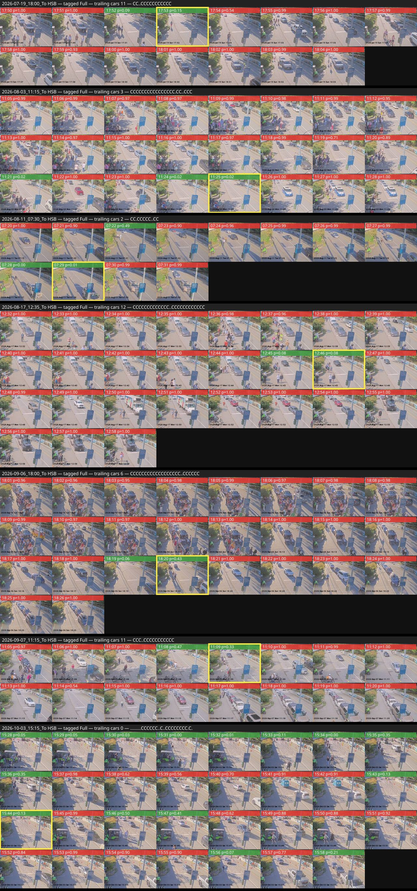
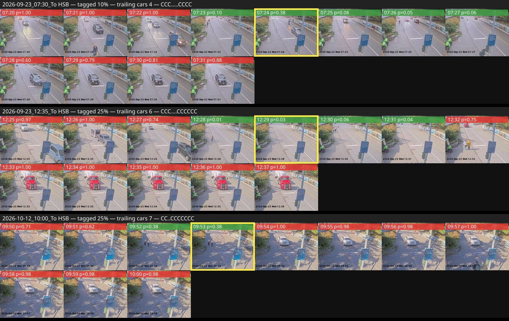

# Not-full rule: one-way empty gap vs the 2026-08-16 tail rule

**Date:** 2026-10-19 · **Script:** `scripts/experiments/empty-gap-one-way.mjs` ·
**Results:** `2026-10-19-empty-gap-one-way-results.json`

## Question

This morning's 05:15 from Bowen loaded (three cars frames 05:05–05:07), read
empty on 05:08 and 05:09 — the robot stamped Not Full — then a car drove in
at 05:14 and sat alone in the lane on the 05:15 departure frame. Two "cars"
frames in a row at the end are *solid cars* under the tail rule of
2026-08-16, so the server cleared the stamp: no verdict, no capacity.

Tom's rule: a car that shows up a few minutes late, after everyone waiting
has boarded, is exactly the case the empty gap is there to catch. If the
lane emptied after loading, the ferry had room; cars after that gap must not
undo it. The 2026-08-16 commit had replaced a rule with that one-way
reading ("later car-filled frames, late arrivals, never clear it") on the
strength of a sweep that found every wrong flag was an empty window with
cars returning after. What does going back to one-way cost and buy on the
archive now?

## Setup

- Every To-HSB sailing with archived terminal frames and a rider capacity
  tag (latest tag wins, `tag-corrections.json` removed): 748 sailings,
  569 tagged with room (anything but Full) and 179 tagged Full,
  2026-07 → 2026-10.
- Frames scored by the live terminal model v11 (texture, `localStd-v1`) from
  the cached per-cell std; cars at p ≥ 0.5.
- Two rules on the same per-frame calls: the tail rule as shipped from
  2026-08-16 (copied verbatim into the script), and the one-way empty-gap
  rule now in `lineup-labels.js`. Both keep two-frame confirmation, solid
  cars-first with the 10-frame quiet-window softening, and blips.

## Results

| month | room / Full | tail flags (room) | gap flags (room) | tail wrong (Full) | gap wrong (Full) |
|---|---|---|---|---|---|
| 2026-07 | 197 / 56 | 138 (70%) | 148 (75%) | 0 | 1 |
| 2026-08 | 189 / 73 | 137 (72%) | 146 (77%) | 0 | 3 |
| 2026-09 | 134 / 37 | 91 (68%) | 104 (78%) | 0 | 2 |
| 2026-10 | 49 / 13 | 36 (73%) | 40 (82%) | 0 | 1 |
| all | 569 / 179 | 402 (71%) | 438 (77%) | 0 | 7 |

The one-way rule asserts every flag the tail rule made (none lost) plus 43
more: 36 on room-tagged sailings and 7 on Full-tagged ones.

The trailing cars run — how many cars frames close the window after the
gap — separates the two groups almost cleanly:

| trailing cars frames | newly right (room) | newly wrong (Full) |
|---|---|---|
| 0–2 | 26 | 2 |
| 3 | 7 | 1 |
| 4–7 | 3 | 1 |
| 11–12 | 0 | 3 |

The seven Full-tagged sailings the one-way rule flags (`C` cars, `.` empty):

```
2026-07-19 18:00  trailing 11  CC..CCCCCCCCCCC
2026-08-03 11:15  trailing  3  CCCCCCCCCCCCCCCC.CC..CCC
2026-08-11 07:30  trailing  2  CC.CCCCC..CC
2026-08-17 12:35  trailing 12  CCCCCCCCCCCCC..CCCCCCCCCCCC
2026-09-06 18:00  trailing  6  CCCCCCCCCCCCCCCCCC..CCCCCC
2026-09-07 11:15  trailing 11  CCC..CCCCCCCCCCC
2026-10-03 15:15  trailing  0  .........CCCCCC..C..CCCCCCCC.C.
```

Four of them refill for 6–12 frames right through departure: a queue that
formed after a mid-window gap, not a late car. The other three are a short
tail of cars after a two-frame gap, indistinguishable by shape from the
late-arrival sailings.

### The frames behind the trailing-run numbers

`scripts/experiments/empty-gap-contact-sheets.mjs` lays out every archived
frame of the sailings a trailing-run cap would touch (red strip = cars,
green = empty, yellow box = the confirming empty frame).





What the pictures say that the shapes don't:

- The long trailing runs on the Full-tagged sailings (07-19 18:00, 08-17
  12:35, 09-06 18:00, 09-07 11:15) are **queues** — several vehicles across
  the lane for 6–12 minutes, on late-running sailings (the 18:00s on a
  summer Sunday and Labour Day Sunday, the 12:35 window running to 12:58).
  The gap was a loading gap: the first batch drove on, more arrived, and
  they did not all fit.
- The long trailing runs on the room-tagged sailings (09-23 07:30, 09-23
  12:35, 10-12 10:00) are **one vehicle** — a single car or truck sitting
  in the lane for 4–7 minutes until departure. The road was empty behind
  it; the 10% / 25% tags fit.
- So the separating signal is *how many vehicles*, not *how many frames*.
  The classifier says cars/no cars and cannot count, which is why a frame
  cap is only a proxy.
- Two of the seven "wrong" flags rest on weak empties: 09-07 11:15 confirms
  on p = 0.47 and 0.33, 09-06 18:00 on 0.06 then 0.43. A confirming pair
  that is barely under 0.5 is a model wobble on a busy road, not an empty
  lane. 08-11 07:30 and 10-03 15:15, by contrast, do show an empty road on
  the confirming frames and are hard to call from the terminal camera at
  all.

Cap arithmetic on this archive, for the record: a cap at 4+ trailing cars
frames would recover 4 of the 7 wrong flags and lose 3 of the 36 right
ones; a cap at 8+ would recover 3 and lose none. Not adopted — see the
conclusion.

## Conclusion

One-way is the rule, by Tom's instruction: an empty gap after loading means
the ferry had room, and cars after it are late arrivals. On the archive
that lifts coverage of room-tagged sailings from 71% to 77% (36 sailings a
rider would otherwise have been asked about) at the price of 7 wrong flags
on 179 Full-tagged sailings (3.9%), where the tail rule had none.

A trailing-run cap ("cars for the last N frames reopens the question")
was considered and rejected (Tom, 2026-10-19) after looking at the frames:
the trailing runs are a mix of the classifier's false non-empty reads on a
busy road and the exact late-arrivals case the empty-gap rule exists for.
A cap would hide per-frame errors inside the sailing rule; those belong in
the label set and the model. The FULL rule (four confident cars frames at
the end, crosswalk reached) can now fire on the same sailing as a
not-full; not full wins everywhere.

## What changed

- `functions/lib/lineup-labels.js` — `terminalEmptyFrameTs` returns the
  first qualifying empty pair after solid cars (or the quiet-window
  softening); nothing after it matters. Not full outranks full.
- `functions/lib/webcam.js` — the streaming stamp is never cleared by later
  cars; a stamped not-full blocks a full stamp.
- `src/lib/tagging-progress.js` — the robot's empty-gap verdict stands when
  a rider tags cars on the departure frame with no crosswalk mark (those are
  the late arrivals); the dialog reason says so.
- Tests in `functions/test/terminal-classifier.test.js` and
  `tests/taggingProgress.test.js`; docs in `docs/lineup-classifier.md`,
  `schema.md`.

## Files

- `scripts/experiments/empty-gap-one-way.mjs`
- `scripts/experiments/empty-gap-contact-sheets.mjs`
- `docs/experiments/2026-10-19-empty-gap-one-way-results.json`
- `docs/experiments/img/2026-10-19-tail-cap-cost.jpg`,
  `docs/experiments/img/2026-10-19-tail-cap-lost.jpg`
